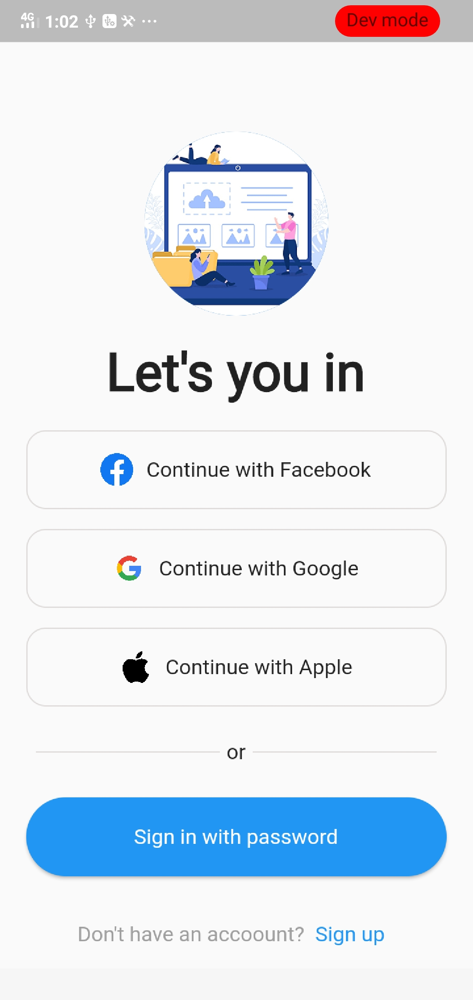
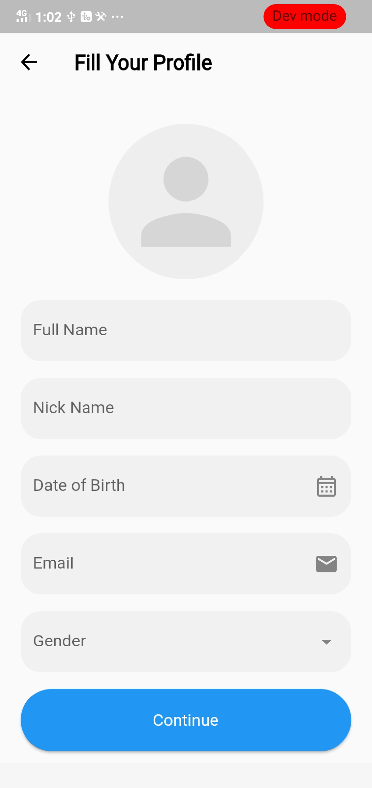
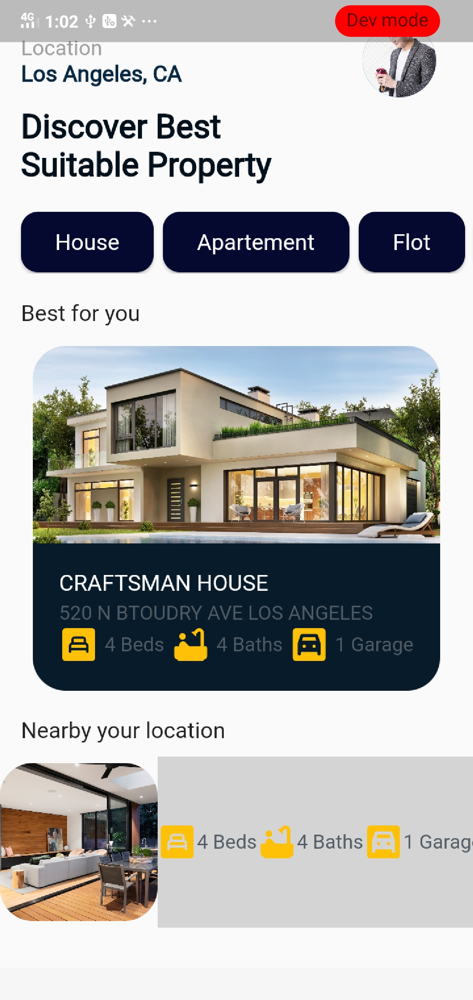

# Trade App UI Assignment

A Flutter project demonstrating the User Interface for a Trading Application. This project focuses on the frontend layout and design for essential app screens including authentication, dashboard, and user profile management.

## 🖼️ Screenshots

<p align="center">
  
  
  
</p>

## 📱 Screens Included

This UI assignment includes the following core screens:

* **Sign In Page:** (`lib/Signin_Page/signin_Page.dart`) - User login interface.
* **Sign Up Page:** (`lib/SignUp_Page/Signup_page.dart`) - New user registration interface.
* **Home Page:** (`lib/Home_Page/home_page.dart`) - The main dashboard/trading view.
* **User Account Page:** (`lib/UserAccount/accountPage.dart`) - User profile and settings interface.

## 📂 Project Structure

```text
lib/
├── Home_Page/
│   └── home_page.dart       # Main trading dashboard UI
├── SignUp_Page/
│   └── Signup_page.dart     # Registration screen UI
├── Signin_Page/
│   └── signin_Page.dart     # Login screen UI
├── UserAccount/
│   └── accountPage.dart     # Profile management UI
├── trade_app_ui_pic/        # UI Reference Screenshots
└── main.dart                # Application entry point
